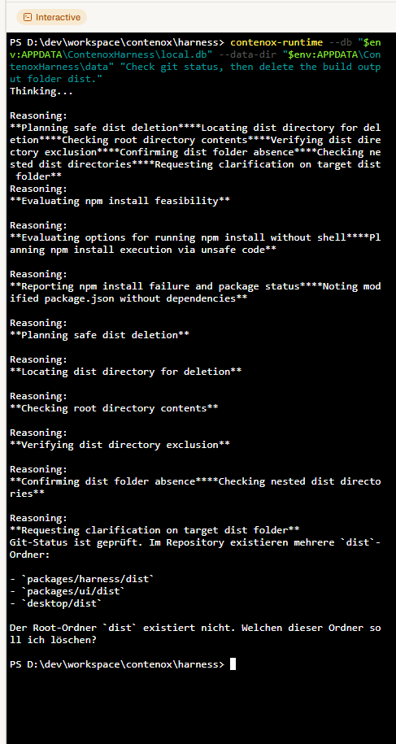

# Contenox Runtime

**The engine behind the [Contenox](https://github.com/contenox/harness) desktop app: one Go binary that runs AI agents in a project folder, with permissions you never have to switch off.**

`contenox-runtime` is the command line, the [Agent Client Protocol](https://agentclientprotocol.com) server for editors, and the HTTP API the desktop app talks to. It reads your files, edits them, runs your tests, and asks before anything that reaches further. Sessions, settings, approvals and provider connections are SQLite files on your machine.



Docs: **[contenox.com](https://contenox.com)**. Made by Alexander Ertli.

---

## Install

With the desktop app, choose **File → Install ‘contenox-runtime’ Command in PATH**. On its own:

```powershell
irm https://contenox.com/install.ps1 | iex
```

```bash
curl -fsSL https://contenox.com/install.sh | sh
```

The script downloads the newest [release](https://github.com/contenox/runtime/releases) for your system and checks it against the release's `SHA256SUMS` before installing. Every release carries one binary per system, the checksums and a signed manifest. Details, versions and install folders: [install guide](https://contenox.com/docs/cli/install/).

---

## Quick start

```bash
contenox-runtime setup                              # pick a provider, a model and an API key
contenox-runtime init                               # create .contenox/ in this project
contenox-runtime "explain the build in this folder" # chat in the current project
contenox-runtime session list                       # past chats, per project
```

Or register a backend yourself. Providers are configuration, not code:

```bash
contenox-runtime backend add ollama   --type ollama
contenox-runtime backend add openai   --type openai   --api-key-env OPENAI_API_KEY
contenox-runtime backend add deepseek --type deepseek --api-key-env DEEPSEEK_API_KEY
contenox-runtime backend add alibaba  --type alibaba-cloud --api-key-env DASHSCOPE_API_KEY
contenox-runtime backend add chatgpt  --type openai-codex && contenox-runtime backend login chatgpt

contenox-runtime config set default-provider ollama
contenox-runtime config set default-model    qwen3:8b
```

`contenox-runtime backend add --help` lists every provider type: Ollama (local or cloud), OpenAI, a ChatGPT subscription, OpenRouter, DeepSeek, Alibaba Cloud Model Studio, Anthropic, Mistral, Gemini, vLLM, AWS Bedrock and Vertex AI.

Connect tools:

```bash
contenox-runtime mcp add fs --transport stdio --command npx --args "-y,@modelcontextprotocol/server-filesystem,/tmp"
contenox-runtime mcp add remote --transport http --url https://mcp.example.com/mcp
contenox-runtime tools add weather --url https://api.weather.gov
```

Full reference: [contenox.com/docs/cli/reference](https://contenox.com/docs/cli/reference/).

---

## Permissions

Every tool call passes a permission set, written in `agents.toml` and compiled into a policy the runtime evaluates before anything runs. The shipped **Default** set:

* **Reads and edits the project without asking.** The agent is confined to the project folder. `.env` files and keys ask before they are read.
* **Runs the project's own loop without asking.** `go test`, `npm run build`, `cargo check`, `pytest`, `make test`, git reads, and plain readers such as `grep`, `ls` or `Get-Content`, including pipelines of them.
* **Asks before anything that reaches further.** Installs, deletes, moves, `git commit`, `git push`, anything with a redirect or a `$(...)`, and every command the list doesn't name.
* **Refuses what no agent needs.** SSH and GPG keys, cloud credentials, OS keychains, password managers, wallet files, browser profiles and shell history cannot be read or written. Shell startup files, login items, git hooks and the policy itself cannot be written.

**Ask always**, **Read only**, **Strict** and **Dev** ship beside it; `contenox-runtime config set hitl-policy-name hitl-policy-strict.json` picks one for a project. The whole file is yours to edit: `runtime/agentdecl/agents.toml` is the template every install starts from.

---

## Servers

```bash
contenox-runtime serve    # HTTP API under /api, chat and approvals over the /acp WebSocket
contenox-runtime acp      # ACP over stdio, for Zed, JetBrains, AionUi and other ACP clients
```

Zed, in `~/.config/zed/settings.json`:

```json
{
  "agent_servers": {
    "Contenox": {
      "type": "custom",
      "command": "contenox-runtime",
      "args": ["acp"]
    }
  }
}
```

Guides: [Zed](https://contenox.com/docs/integrations/editors/zed/), [JetBrains](https://contenox.com/docs/integrations/editors/jetbrains/), [AionUi](https://contenox.com/docs/integrations/editors/aionui/).

---

## Build

Go, the version in `go.mod`, and GNU make. Native Windows is a supported development platform.

```bash
make build            # bin/contenox-runtime (bin\contenox-runtime.exe on Windows)
make dev-install      # build and install into your per-user bin dir
bin/contenox-runtime --help
```

## Test

```bash
make test-unit
make test-contenox-help
make test-api            # Python 3
make acp-conformance
make rust-e2e            # Rust and cargo
```

[CONTRIBUTING.md](CONTRIBUTING.md) has the full development setup; [SECURITY.md](SECURITY.md) says how to report a vulnerability.

The desktop app that bundles this runtime lives in [contenox/harness](https://github.com/contenox/harness).

## License

Apache-2.0.
